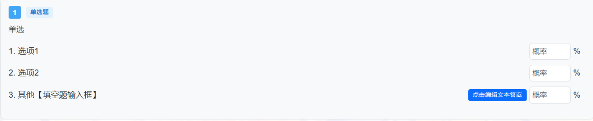
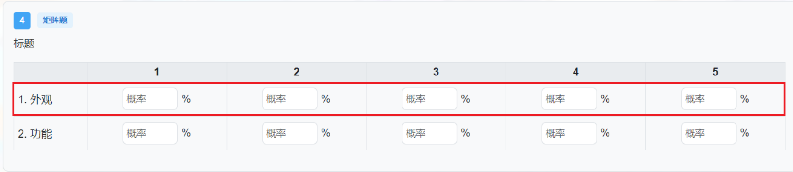

# 问卷星助手（wjx-desktop）

> **Windows 桌面版**：把问卷星答卷生成做成了点击即用的桌面软件，协议级提交，不用在浏览器里逐份点选。
> 相见就是缘分，喜欢的话可以点一个 star~，非常感谢！！！
> 想体验基础版效果可去 ---> www.yoonheart.me

> [下载 Windows 桌面版 / Download](https://github.com/yoonheart/wjx-desktop/releases/latest) · [问题反馈 / Issues](https://github.com/yoonheart/wjx-desktop/issues)<br>
> 如果下载速度太慢，可通过百度网盘下载：https://pan.baidu.com/s/1mBCsff2N4Rfavfieq8t7Xg?pwd=5iqh （提取码：5iqh）

> **作者 Author: YoonHeart**

> **⚠️ 非商用声明 Non-Commercial Notice：** 本软件仅供个人学习、研究与免费使用，**禁止任何形式的商业售卖、转卖、套壳换皮重新发布**，也禁止用于刷量或污染他人问卷数据（详见 [LICENSE](LICENSE)）。发现闲鱼/淘宝等渠道倒卖请告知作者，感谢！

    

---

## ✨ 主要功能

- **8 类题型**：单选 / 多选 / 填空 / 量表 / 矩阵 / 下拉 / 滑块 / 排序，全部解析与编码。
- **答案可控**：按题设置选项概率、多选命中分布，矩阵题逐格配置。
- **协议级提交**：直接按平台请求格式发出，不在浏览器里逐份点选。
- **可复现**：同一个 `seed + 份号` 永远生成同一份答案。
- **结果可信**：三层节奏（令牌桶 / 对数正态冷却 / 出口配额）；结果分「成功 / 需验证 / 关闭 / 限次 / 未知」，未知绝不冒充成功。
- **可验证**：`verify` 只打印请求不发送；每份提交落库，支持 CSV 导出。
- **数据目标**：按信度 α / 效度 KMO / 显著性反推答卷结构；结局（因变量）支持单选题、
  量表题、矩阵的某一行，或矩阵多行取均值。详见 `docs/architecture.md` 第 10 节。

## 🖼️ 界面预览

<table>
  <tr>
    <td align="center"><br/><sub>单选题 · 选项概率</sub></td>
    <td align="center"><br/><sub>矩阵题 · 逐格概率</sub></td>
  </tr>
</table>

## 🚀 从源码运行

需要 Windows 10/11 + Python 3.11+：

```powershell
git clone https://github.com/yoonheart/wjx-desktop.git
cd wjx-desktop
python -m venv .venv
.\.venv\Scripts\python.exe -m pip install -e .
.\.venv\Scripts\python.exe app\main.py
```

只想起服务、不开窗口：

```powershell
.\.venv\Scripts\python.exe app\main.py --no-window
```

## 🖥️ 使用步骤

1. 打开软件，粘贴问卷链接；
2. 自动解析题目结构；
3. 按题调整选项概率 / 答案；
4. 设置目标份数与节奏，点开始；
5. 跑完查看结果，需要时导出 CSV。

## 📂 数据位置

`%LOCALAPPDATA%\wjx-desktop\`：`wjxdesk.db`（任务与逐份记录）、`profile.json`（当前方案）、`logs/`、`export/`。

## ⚠️ 使用边界

- 只支持公开可访问的问卷；微信环境、登录态、需要人工验证的场景会明确拒绝并提示。
- 不破解验证码、不模拟鼠标、不提供刷量服务；遇到「需要验证」只暂停提示。
- 代理出口由外部提取链接提供，程序不内置、不筛选地区。

## 📄 License

本项目采用 **非商业使用许可证**，仅供个人学习、研究与免费使用，禁止商业用途。详见 [LICENSE](LICENSE)。
